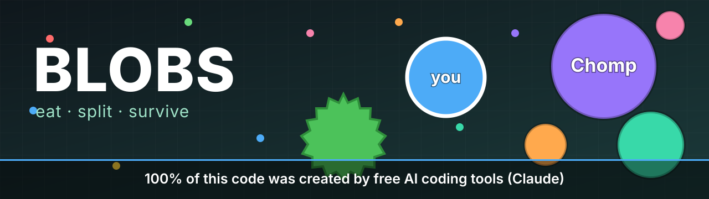

<p align="center">
  
</p>

<h1 align="center">🫧 Blobs</h1>

<p align="center">
  <b>A real-time multiplayer blob-eating game that runs in your browser.</b><br>
  Munch food, gobble smaller players, dodge the big ones, and try not to get eaten.
</p>

<p align="center">
  <a href="https://anantojha.github.io/agar-io-clone/"><b>▶️ Play it now</b></a>
  &nbsp;·&nbsp;
  <a href="#-how-to-play">How to play</a>
  &nbsp;·&nbsp;
  <a href="#-run-it-yourself">Run it yourself</a>
  &nbsp;·&nbsp;
  <a href="#-how-its-built">How it's built</a>
</p>

<p align="center">
  <a href="https://github.com/anantojha/agar-io-clone/actions/workflows/test.yml"></a>
  
  
  
</p>

> 🤖 **100% of this code was created by free AI coding tools (Claude).**
> Every line of the game, the server, the tests and the deployment setup came out of AI-assisted
> coding sessions. This repo is a real-world experiment in how far free AI tools can take a project.

---

## 🎮 How to play

Open the game, type a name, hit **Play**, and start eating.

| Do this | To do that |
|---|---|
| 🖱️ **Move the mouse** (or drag a finger) | Steer your blob toward the cursor |
| ⎵ **Space** (or the **Split** button) | Split in half and fling the new half forward, ideal for catching prey |
| **W** (or the **Eject** button) | Spit out a bit of your mass. Hold it to keep feeding a friend, or to bait a trap |

**The rules of the blob world**

- 🟢 **Eat food** to grow. There are 1,500 colorful pellets scattered across the map.
- 🔵 **Eat smaller blobs.** You need to be at least **25% bigger** and cover their center.
- 🔴 **Run from bigger blobs.** The same rule applies to you.
- 🦠 **Viruses** (the green spiky ones) burst big blobs into a pile of pieces. Small blobs can hide behind them.
- 🧩 **Pieces merge back** together after a cooldown, and bigger blobs take longer.
- 🐌 **Bigger means slower.** Size is power, and also a target.
- 🤖 **Bots fill the lobby**, so the map is never empty. They flee, chase, split-attack, and avoid viruses.
  Real players take the bots' places, so the world stays the same size no matter how many people join.

> ⏳ **Heads up:** the demo runs on a free server that naps when nobody's around. The first visit can show
> **"Waking the server…"** for up to about a minute. After that it's quick.

---

## 🧰 How it's built

No game engine, no frameworks, no build step. Just a small Python server and a plain JavaScript canvas client.

```
   ┌────────────────────┐        WebSocket         ┌──────────────────────────┐
   │  Browser (canvas)  │ ◄──────────────────────► │  Python server (Starlette)│
   │  client/           │  JSON: join, move, split │  server/  +  game/        │
   │  plain JS, no build│  Binary: world snapshots │  30 ticks/sec simulation  │
   └────────────────────┘                          └──────────────────────────┘
        GitHub Pages                                       Render (Docker)
```

- **Authoritative server.** All the rules live in `game/` (a pure simulation with no networking), so the
  server decides who ate whom and clients can't cheat their way to the top.
- **Compact binary protocol.** World snapshots are packed binary frames, much smaller than the JSON
  they replaced. `client/protocol.js` decodes the same layout as `server/protocol.py`, and a test runs
  both against each other so they can't drift apart.
- **Spatial hashing.** Collision and view queries use a bucketed grid, so cost stays low as the map fills up.
- **Smooth motion.** The server sends about 15 updates a second and the client glides between them,
  so it looks like a smooth 60 fps game.
- **Built for a tiny free host.** The server pauses its tick loop when nobody is connected, bots only fill
  the gap up to a target population, and every connection has rate, per-IP and idle limits.

### 🗂️ Project layout

```
client/        the browser game: index.html, game.js, protocol.js, config.js
game/          the rules: world, cells, food, viruses, spatial grid (no networking)
server/        WebSocket server, bots, binary protocol, abuse limits
tests/         pytest suite for the rules, bots, protocol, limits and server
bench/         bot simulation experiments used to tune the game
tools/         load testing against a running server
deploy/        deployment config (render.yaml)
docs/          the banner image
Dockerfile     one image runs the whole thing
```

---

## 🚀 Run it yourself

### The quick way (Python 3.12)

```bash
git clone https://github.com/anantojha/agar-io-clone.git
cd agar-io-clone
pip install -r requirements.txt
uvicorn server.app:app --port 8000
```

Then open <http://localhost:8000>.

> **Playing locally?** `client/config.js` points at the hosted demo server. To use your local one instead,
> set `server: ""` in that file. An empty value means "the same host that served this page".

### With Docker

```bash
docker build -t blobs .
docker run --rm -p 8000:8000 blobs
```

Open <http://localhost:8000>. The container listens on `$PORT` (default `8000`), runs as a non-root user,
and answers `/health` for health checks.

### Run the tests

```bash
pip install -r requirements-dev.txt
python -m pytest -q
```

---

## ⚙️ Settings

The server is configured with environment variables. All of them are optional.

| Variable | Default | What it does |
|---|---|---|
| `AGAR_BOTS` | `15` | Target population. Bots fill only the gap left by real players |
| `AGAR_MAX_PLAYERS` | `25` | Most open connections at once; extra visitors get a "server full" screen |
| `AGAR_MAX_PER_IP` | `5` | Most connections from a single address |
| `AGAR_ALLOWED_ORIGINS` | *(any)* | Comma-separated list of sites allowed to connect, for example `https://you.github.io` |
| `AGAR_TRUST_PROXY` | off | Set to `1` behind a proxy so the real client address is used |
| `AGAR_SEND_EVERY` | `2` | Ticks between world snapshots; raise it to save bandwidth and CPU |
| `AGAR_PAUSE_AFTER` | `60` | Seconds with nobody connected before the game loop sleeps (`0` = never) |
| `AGAR_IDLE_TIMEOUT` | `30` | Seconds of silence before a connection is closed |
| `AGAR_MSG_RATE` / `AGAR_MSG_BURST` | `60` / `120` | Per-client message rate limit |
| `AGAR_DROP_AFTER` | `300` | Messages dropped by the rate limit before the client is disconnected |

`GET /health` shows what the server is doing: players, bots, how long a tick takes, and whether it's paused.

---

## ☁️ Deploying your own copy

The whole thing is deployable for free, with **no credit card** on the hosts used here.

1. **The game server** goes on [Render](https://render.com) as a free Docker web service
   (see [`deploy/render.yaml`](deploy/render.yaml)). Set `AGAR_TRUST_PROXY=1` and
   `AGAR_ALLOWED_ORIGINS` to your GitHub Pages address (the origin only, no path).
2. **The browser client** goes on GitHub Pages. Under Settings → Pages, set the source to **GitHub Actions**.
   The included workflow publishes `client/` on every push to `main`.
3. **Connect them** by setting `server` in `client/config.js`, or by setting the repository variable
   `AGAR_SERVER_URL` to `wss://your-service.onrender.com/ws`.

Free-tier things to know:

- 😴 Free Render services sleep after about 15 minutes idle. The client shows a "Waking the server…"
  screen and retries for about 90 seconds.
- 📶 Free bandwidth is limited, and a card-free account is suspended for the rest of the month if it runs out.
  The game is lightweight, but it's meant for friends and demos, not a huge crowd.
- 🐢 A free instance has a fraction of a CPU, so keep `AGAR_MAX_PLAYERS` modest and watch `tick_ms` in `/health`.

---

## 🛠️ Hack on it

Some fun places to start:

- 🎛️ Tweak the feel in [`game/config.py`](game/config.py): speed, decay, split and eject costs, virus count, map size.
- 🧠 Make the bots smarter in [`server/bots.py`](server/bots.py).
- 🎨 Change how everything looks in [`client/game.js`](client/game.js).
- 🏆 Add a new rule to the world in [`game/world.py`](game/world.py), then write a test for it in `tests/`.

---

## 🤖 About the AI

This project was created **100% by free AI coding tools (Claude)**: the game rules, the server, the
client, the tests, the Docker image, the CI, and this README. AI-written code can have bugs and rough
edges like any code, so issues and pull requests are very welcome.

## 📜 License

[MIT](LICENSE). Play with it, learn from it, break it, remix it.

<p align="center"><sub>Inspired by classic blob-eating games. Not affiliated with any of them.</sub></p>
